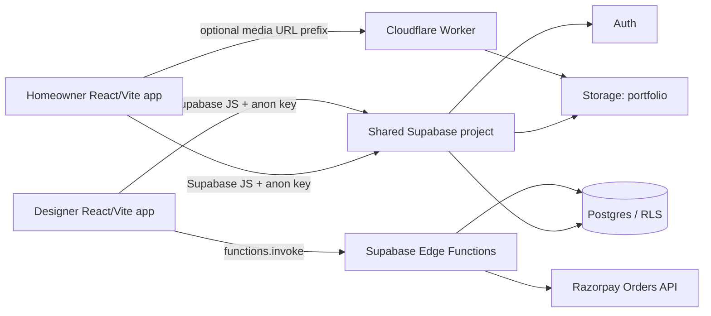
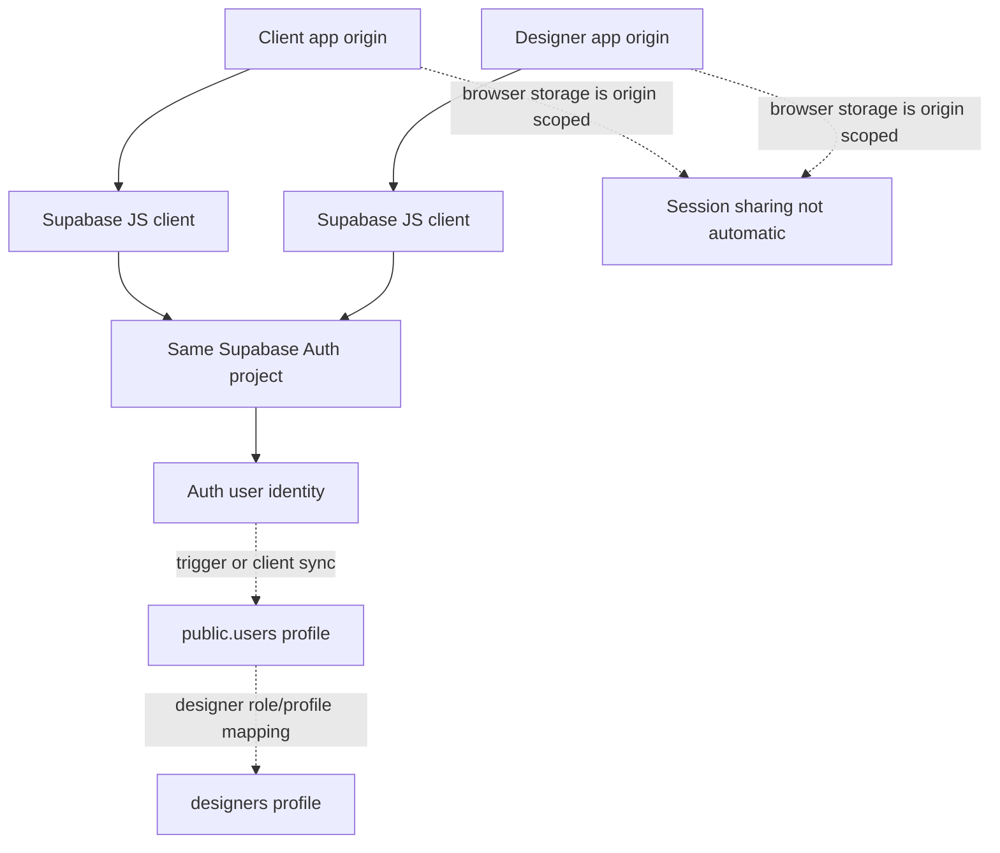

# System architecture

Both `src/config.js` files read `VITE_SUPABASE_URL`, `VITE_SUPABASE_ANON_KEY` and optional `VITE_MEDIA_BASE_URL`; `src/supabaseClient.js` calls `createClient`. Values are intentionally excluded. Separate browser origins generally have separate local storage, so one Supabase project does not prove cross-domain session sharing. Auth redirect allowlists and provider config need live verification.

Client routes are public discovery/static pages, guest-only auth, auth-gated connect/profile and admin-gated admin screens. Designer routes include auth-gated onboarding/waitlist/profile/connect and a designer guard for dashboard. Guards are UX controls; RLS/server authorization is decisive.

Designer dashboard uploads directly to Storage `portfolio`, obtains public URLs and stores metadata in `project_images`. Homeowner config can prefix media paths with a Worker/CDN base. Worker source proxies public objects and caches them as immutable for one year; deployment/wiring and object-key immutability are unverified.

`supabase/migrations/0001_phase1_hardening.sql` adds view indexes/policies, `daily_view_counts`, `mv_public_marketplace_feed`, refresh trigger/function, and `users.profile_completed` plus `handle_new_user()`. This is migration intent, not deployed verification. See database and open-questions documents.
