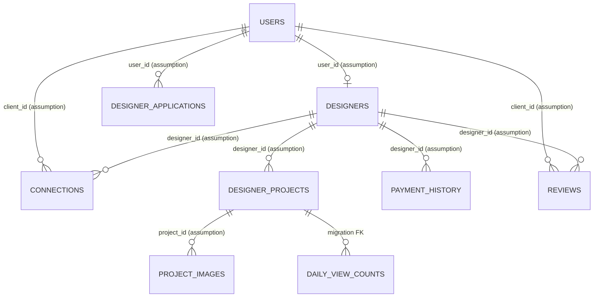

# Database schema and relationships

**Evidence:** No live DB catalog was inspected. The sole migration creates only some objects; table names/relationships from prompt are supplied clues. App query columns establish usage, not types or foreign keys.

| Object | Observed purpose | Evidence/limits |
|---|---|---|
| `users` | Auth/profile/role | Migration adds `profile_completed`; trigger inserts basic profile. Full schema absent. |
| `designers` | Marketplace profile, verification, subscription, featured fields | Both apps read/write; constraints/types unknown. |
| `designer_applications` | Onboarding submission and admin reads | Full status lifecycle unknown. |
| `designer_projects` | Portfolio projects/status | Migration joins and filters `status='approved'`. |
| `project_images` | Project image URL/cover metadata | Migration reads `project_id`, `image_url`, `is_cover`. |
| `connections` | Client-designer leads | Both apps query and mutate; policy unknown. |
| `reviews` | Ratings/reviews | Client reads/inserts; migration indexes `client_id`. |
| `contact_messages` | Contact form/admin triage | Source operations; no schema in migration. |
| `payment_history` | Payment records | Edge Function insert/dashboard read; schema unknown. |
| `project_views_log` | View analytics | Migration uses project_id/viewed_at, changes policy/index. |
| `daily_view_counts` | Daily aggregates | Migration creates project_id bigint FK, date, integer count; composite PK; RLS enabled. |
| `mv_public_marketplace_feed` | Public marketplace cache | Migration-defined projection; SELECT granted to anon/authenticated. |
| `mv_refresh_state` | Refresh throttle | Migration creates singleton id and timestamp. |

Only `daily_view_counts.project_id -> designer_projects.id` is explicitly declared as a foreign key in the available migration. Prompt-listed relationships are unverified.

Migration also defines `handle_new_user()` (SECURITY DEFINER, locked search_path), `debounced_refresh_marketplace()`, statement trigger `trg_debounced_refresh_feed`, pg_cron `rollup_daily_views`, and indexes on connection/review/view columns. It calls but does not define frontend RPC `increment_profile_view`. Verify deployed migration state.
