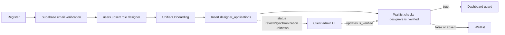
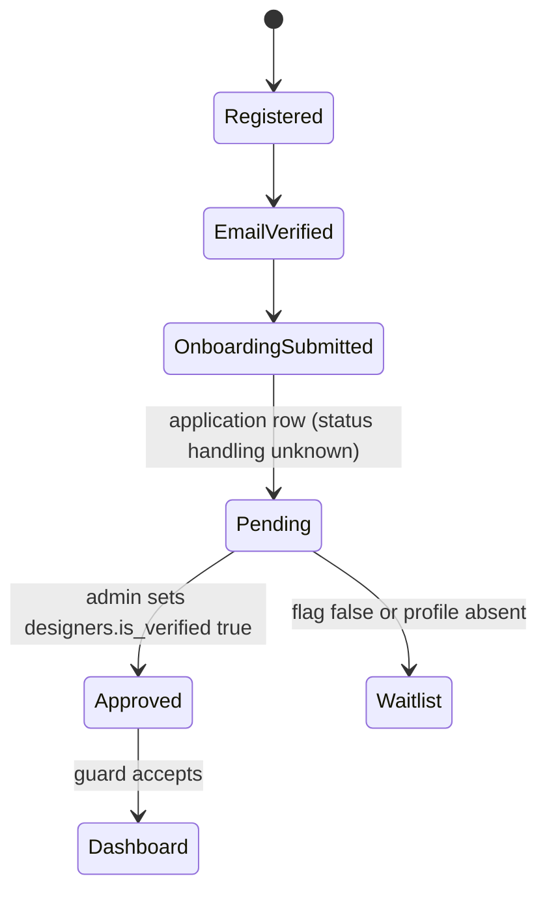
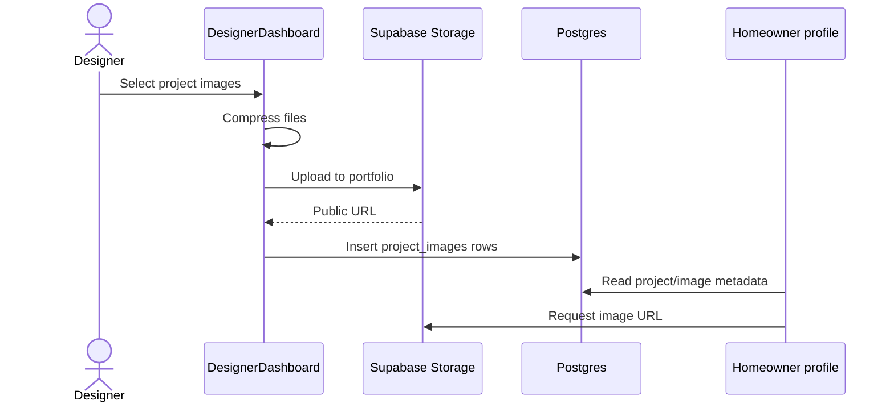
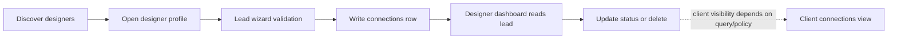
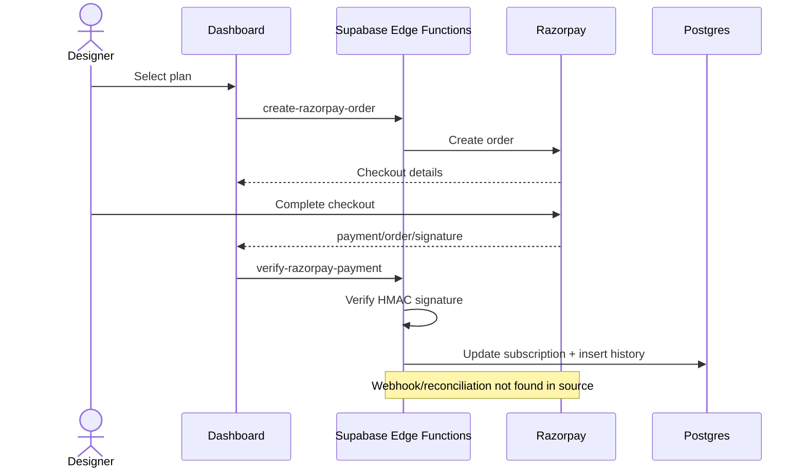

# Business logic and user flows

## Client auth/profile
Register → auth service signup with current-origin email redirect and metadata → Supabase Auth → callback/session → optional profile completion writes `users`. Migration defines a new-user trigger function, but attachment is unknown. Google button calls OAuth service; provider setup is external. Auth/profile synchronization failure can leave partial state.

```mermaid
sequenceDiagram
  actor Client
  participant UI as Register/Login
  participant Auth as Supabase Auth
  participant DB as users table
  Client->>UI: Submit credentials / Google
  UI->>Auth: signUp or OAuth
  Auth-->>Client: verification redirect/session
  Note over Auth,DB: handle_new_user exists in migration; trigger attachment unknown
  Client->>UI: Return and restore session
  UI->>DB: Fetch/update profile as needed
```

## Designer onboarding/approval
Register → Auth signup → `users` upsert as designer → email verification → session → `UnifiedOnboarding` reads existing data, validates and inserts `designer_applications`, updates `users` → `Waitlist` reads `designers.is_verified` → dashboard guard admits eligible designer. Admin UI updates `designers.is_verified`; full application review/status sync is not established.



Approval specifically depends on the `designers.is_verified` check found in the designer waitlist/guard code. The handoff from `designer_applications` to that profile flag is not demonstrated as an enforced backend workflow.



## Projects and media
Dashboard loads designer and nested project/image data → inserts project → compresses/uploads to `portfolio` → obtains public URL → inserts `project_images`. Edit path deletes image metadata/adds new uploads. Separate DB/storage calls can partially fail. Public profile renders projects/images; storage object cleanup on delete needs confirmation.



## Discovery and lead
Client loads designer list, applies UI filters, opens profile, reads portfolio/reviews, then lead wizard validates fields and writes/upserts `connections`. Designer app queries leads and updates status/timestamp or deletes. Client-side validation and guards do not establish RLS behavior. Verify deployed policies for ownership and subscription restrictions.



## Payments
Plan action → invoke `create-razorpay-order` → Edge Function calls Razorpay Orders API → browser Checkout → success response includes payment/order/signature → invoke `verify-razorpay-payment` → server HMAC verification → subscription update and payment history insert. No webhook, reconciliation or scheduled expiry flow was found. Verify idempotency/deployment/secrets.



Contact form writes `contact_messages`; admin triages. Reviews are queried/inserted through client services. Logout calls Supabase sign-out; auth hooks observe state. Production RLS and error outcomes remain unverified.
